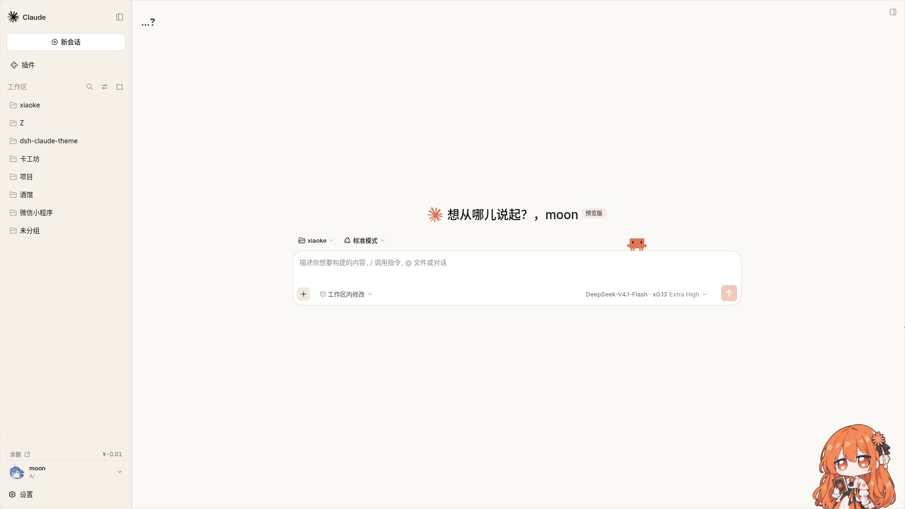
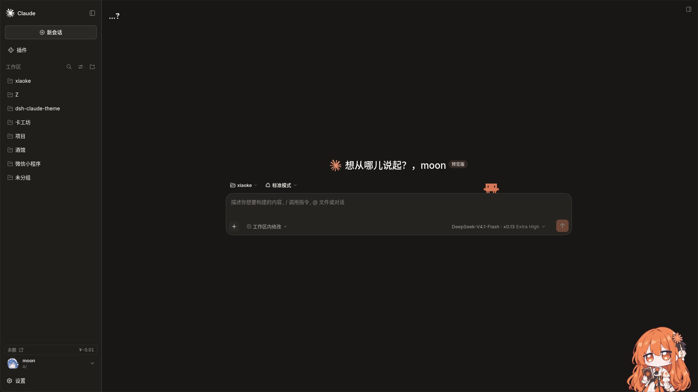

|  |  |
| --- | --- |

> ~~**These two look like a pair of star-crossed lovers to me.**~~

# Claude — a DSH Web GUI theme

> ~~**If Anthropic considers this an infringement, contact me and I will take it down.**~~

Makes the DSH Web GUI look like the claude.ai app: warm cream canvas, serif reading text, coral accent.

There are six things in this repository. **Install only what you want; you do not need all of them.**

| What you want | What to install |
| --- | --- |
| Different colours, fonts and interface details | The `claude/` skin, through the skin center or `plugins/skin/` |
| The Claude sidebar mark, display name, avatar and loading animation | `brand-plugin/` |
| A pixel crab that blinks and gets sleepy | `crab-plugin/` |
| Your own three font groups | `plugins/font-switcher/` |
| Open DSH on your phone over the same Wi-Fi | `plugins/lan-access/`; see [its guide](plugins/lan-access/README.md) |
| Load the skin without the skin center and get the Claude-X settings page | `plugins/skin/` |

**The skin center alone is enough for the visual theme, but not for the plugin features**: the Claude branding, name and avatar, loading animation, font switching and pixel crab. Those live in their own plugins, not in the skin's CSS.

`plugins/lan-access/` changes DSH's listening configuration so other devices on your network can open the interface. **Do not install it if you do not need phone access.**

## What it looks like





These are screenshots of the real interface: warm cream in light mode and warm black in dark mode, not a simple colour inversion.

## What you get

- **Warm cream and warm black canvases**, with Newsreader for prose and headings, Inter for buttons and menus, and JetBrains Mono for code.
- **Four font files included**, with system fonts as the Chinese fallback.
- **Claude branding in the sidebar**, plus an editable display name, subtitle and avatar. New installs show `moon`.
- **Three loading-animation choices**: the eight-shape starburst loop, a pixel crab at a keyboard, or the original whale tail. The default is starburst, selected in **Settings → Claude-X**.
- **24 rotating greetings**, starting with a time-of-day greeting and using your chosen name.
- **A pixel crab** that watches your pointer, blinks, gets sleepy and says something when poked. It only lives in `crab-plugin/`; the skin does not draw a second one.
- **Other plugins get a more consistent look too**, so they do not introduce a loud, unrelated card style.

The skin controls appearance; branding, avatar, loading animation and the crab need their respective plugins. **The skin and plugins work independently**: skin-only installs keep the colours and fonts; plugin-only installs work too, with the stock theme colours.

## Install

Install each piece separately and restart DSH. **Only the skin needs you to choose an installation route. Do not use both routes. The standalone skin plugin is recommended: it includes the complete settings page and does not require a separate skin center.**

### 1. The skin

**Option A: the skin center.** Install `@linxin666/dsh-client-ui-skin-center`, find Claude in its marketplace, then select it in **Settings → Skin Center**. No manual copying and no restart.

**Option B: the standalone skin plugin (recommended).** No skin center required:

```bash
dsh plugin --profile web add link:/path/to/dsh-claude-theme/plugins/skin
```

After restarting, select Claude in **Settings → Claude-X**. The plugin copies `claude/` into `$DSH_HOME/skins/claude` itself. Existing files are not overwritten.

### 2. The Claude brand plugin

```bash
dsh plugin --profile web add link:/path/to/dsh-claude-theme/brand-plugin
```

After restarting, the sidebar mark and wordmark become Claude's, and the browser title and icon change too. You can also edit the name, avatar and loading animation.

With only this plugin, click the row at the bottom of the sidebar to edit the name and avatar. Adding `plugins/skin/` also gives you **Settings → Claude-X**, where the loading-animation choice lives.

### 3. The pixel crab

```bash
dsh plugin --profile web add link:/path/to/dsh-claude-theme/crab-plugin
```

After restarting, the crab appears above the composer. Poke it for a reaction.

### 4. Font switching

```bash
dsh plugin --profile web add link:/path/to/dsh-claude-theme/plugins/font-switcher
```

Restart, open **Settings → Fonts**, put your font files in the folder it shows, and click rescan. You can sort them into `serif/`, `sans/` and `mono/` subfolders.

Bring your own fonts; the repository only includes the four used by the skin.

### 5. Phone access (optional)

```bash
dsh plugin --profile web add link:/path/to/dsh-claude-theme/plugins/lan-access
```

Restart, open **Phone access** in the sidebar, turn on the switch, and restart once more when prompted. After that, scan the QR code in the panel to open DSH on your phone.

**The link in the QR code is an access credential.** Do not share it, and only enable LAN access on a network you trust. See [`plugins/lan-access/README.md`](plugins/lan-access/README.md) for the details.

For more detailed installation, troubleshooting and rollback steps, see [`INSTALL.md`](INSTALL.md). **Too lazy? Hand the installation to DSH, Claude Code or Codex.**

### A few things about installation

**This repository is not published to npm.** Every plugin is installed from a local clone, with `link:` pointing at *your own* clone path — that is what the commands above do. Packages with the same names on npm are not from here; do not mix them up.

**Do not install with a `github:` dependency plus `link:node_modules\<repo>\<subdir>`.** The repo root has no `package.json`; we have not tested that combination and do not support it. One user reported it failing on Windows: `pnpm` cannot replace the directories while DSH holds them and hits `EPERM`, after which those subdirectories are stuck in a delete-pending state that only clears once DSH is fully quit — while the UI only shows a bare "no write permission".

**This project is developed and maintained on Linux.** We cannot verify Windows-specific behaviour. The paragraph above relays someone else's report, not a conclusion we reproduced. If you hit trouble on Windows, an issue describing the symptoms is welcome, but please understand we may not be able to follow it to the end.

If you already use that install shape and it works, there is no need to migrate — just do not assume DSH or these plugins are broken first if something goes wrong.

## How the pieces fit together

- The display name, subtitle and avatar live in `dsh-claude-brand.prefs`. The sidebar popover and Claude-X edit the same record, so both stay in sync.
- The loading-animation choice is stored in that same record and is currently selected on the Claude-X page.
- The two plugins cannot share a module scope, so they use localStorage for shared data and a window event to notify each other.
- The font switcher only works with the active skin; without a skin, it has nothing to change.
- Brand replacement is not part of the skin because the skin center does not run official hooks from local skins. Logo changes have to be done by a plugin. See the limitations below.

## Layout

```
dsh-claude-theme/
├── claude/                          # the skin itself
│   ├── skin.json                    #   what the skin is (name, author, palette)
│   ├── skin.css                     #   all the colours and fonts
│   ├── patches.css                  #   the fine-tuning (radii, composer, cards, scrollbars)
│   ├── assets/fonts/                #   the four font files + a re-download script
│   ├── preview/                     #   preview images (real screenshots, light + dark)
│   ├── crab.generated.css           #   the pixel sparkle by the greeting (generated, don't edit)
│   └── patches.base.css             #   the hand-written draft behind patches.css
├── plugins/
│   ├── skin/                        # the skin plugin
│   │   ├── README.md                #   how it makes the skin take effect
│   │   ├── lib/index.js             #   reads the skin, puts styles on the page, serves assets
│   │   ├── lib/css-contract.js      #   stylesheet rewriting (see its own README)
│   │   ├── lib/client.js            #   the Claude-X settings page
│   │   └── test/                    #   unit tests
│   └── font-switcher/               # the font-switcher plugin
│       ├── README.md
│       ├── lib/index.js             #   scans the font folder
│       └── lib/client.js            #   the font settings page
├── plugins/lan-access/              # LAN access plugin (independent of the skin)
│   ├── README.md                    #   installation, usage and safety
│   ├── lib/index.js                 #   listener configuration, links and QR code
│   └── lib/client.js                #   the phone-access panel
├── crab-plugin/                     # the Clawd plugin
│   ├── LICENSE                      #   MIT + Clawd attribution
│   ├── README.md
│   ├── docs/preview.png             #   preview image
│   └── lib/client.js                #   the crab: pixel art, animation, lines
├── pet/                             # the crab spritesheet for the pet system
├── brand-plugin/                    # the Claude plugin
│   ├── README.md
│   ├── assets/default-avatar.webp   #   the default avatar
│   └── lib/client.js                #   starburst, wordmark, greeting, name and avatar
├── cover/                           # cover art (video cover + repo card ratios)
├── scripts/                         # maintenance scripts (regenerate, validate, screenshot)
├── README.md                        # Chinese
├── README.en.md                     # this file
├── INSTALL.md                       # step-by-step install and troubleshooting
└── LICENSE                          # MIT + font and trademark notices
```

Script usage is documented in [`scripts/README.md`](scripts/README.md).

## Limitations

- **Skins can't run the official hooks.** The skin center only admits skins installed from its marketplace and refuses local ones outright. That's why swapping the logo is a plugin, not part of the skin.
- **Remote fonts differ by route.** Through the skin center, fonts must live inside the skin directory — anything referencing outside gets rejected. The standalone plugin doesn't enforce this — and therefore doesn't check anything for you either, so only run skins you wrote or can read yourself.
- **The tool-call cards are an impression, not a replica.** claude.ai has no such thing (they're DSH-specific UI), so they're redrawn in Claude's style rather than copied.
- **The crab's art comes from someone else.** The pixel matrix is from the SillyTavern extension [claude-web](https://github.com/claudenoshujin/claude-web) by **claudenoshujin** — the drawing credit is his. The selectors, animation, colours and placement here are original. See [License and notices](#license-and-notices).
- **The pet-panel crab doesn't move.** The pet system wants a nine-frame animation sheet, but the crab only has one static pose, so all nine cells are the same crab in different tints. Real animation needs actual art.
- **The crab skips the official slot system.** It used to go through it, and it went badly: errors got swallowed, the plugin loaded but no crab appeared, and nothing was logged. It now mounts straight onto the composer. The cost: if the official marker for that spot ever changes, the crab disappears — but you'll get a console warning, not silence.
- **The skin no longer draws its own crab.** It used to carry a static one that fought with the plugin's crab (two crabs, or none), so it was removed. The crab lives only in the plugin now — skin without plugin means no crab.
- **The skin only applies while selected.** Everything is scoped inside the skin's own namespace, so other skins don't pick it up. Both install routes behave this way.

## License and notices

- Code and CSS: MIT, see [`LICENSE`](LICENSE).
- Vendored fonts: Newsreader, Inter and JetBrains Mono are licensed under the SIL Open Font License 1.1 and are included in `claude/assets/fonts/`.
- Trademarks: this is an **unofficial fan tribute**. "Claude" and "Anthropic" are trademarks of Anthropic PBC. This project is not affiliated with or endorsed by Anthropic.
- **Clawd attribution.** Clawd, the pixel crab mascot of Claude Code, belongs to Anthropic. The crab in this repo is **pure CSS**, generated by `scripts/gen-crab.py` from dot-matrix data with no image files. The geometry comes from the SillyTavern extension [claude-web](https://github.com/claudenoshujin/claude-web) by **claudenoshujin** — credit for the original pixel art belongs to that author. This project reuses the geometry only and copied no files from that repo; the selectors, animation, colours and placement are its own.
- **Starburst artwork.** The star shapes used by the loading animation belong to Anthropic and are used here as an unofficial fan tribute. This project is not affiliated with or endorsed by Anthropic.
- **Copernicus and StyreneB are not included.** Those are Anthropic's actual typefaces and are licensed fonts that cannot be redistributed. This project substitutes the open Newsreader (for Copernicus's serif role) and Inter (for StyreneB's sans role) — similar in spirit, not identical.

## Credits

- The skin-center plugin [`@linxin666/dsh-client-ui-skin-center`](https://github.com/zhu1090093659/dsh-web), which provides skin loading, manifest validation, CSS sanitization and live switching.
- The type designers behind Newsreader, Inter and JetBrains Mono, and Google Fonts' latin subset builds.
- Anthropic's claude.ai interface, whose look this project reproduces.
- The SillyTavern extension [claude-web](https://github.com/claudenoshujin/claude-web) by **claudenoshujin**: source of the Clawd pixel geometry, and a key reference for the palette.
