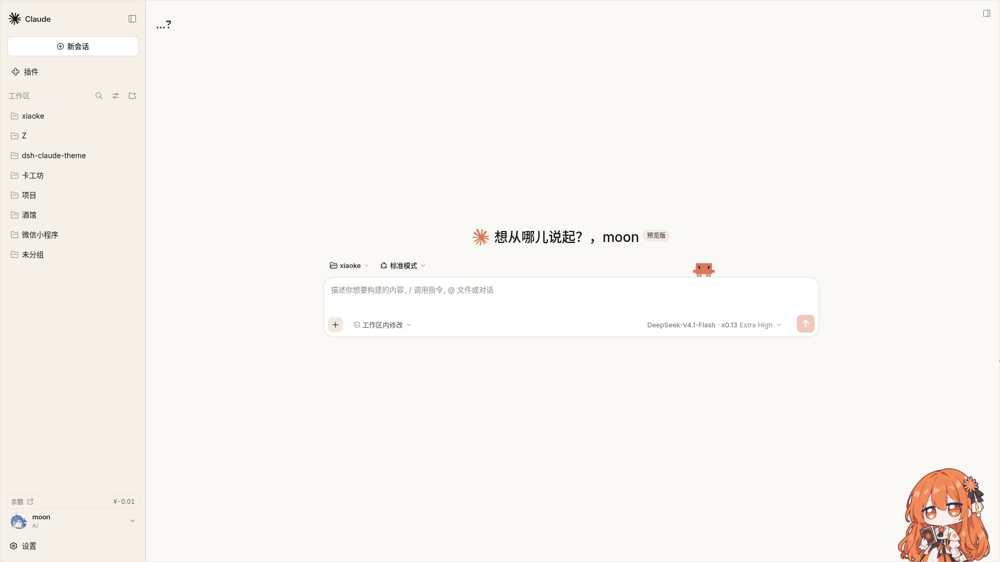
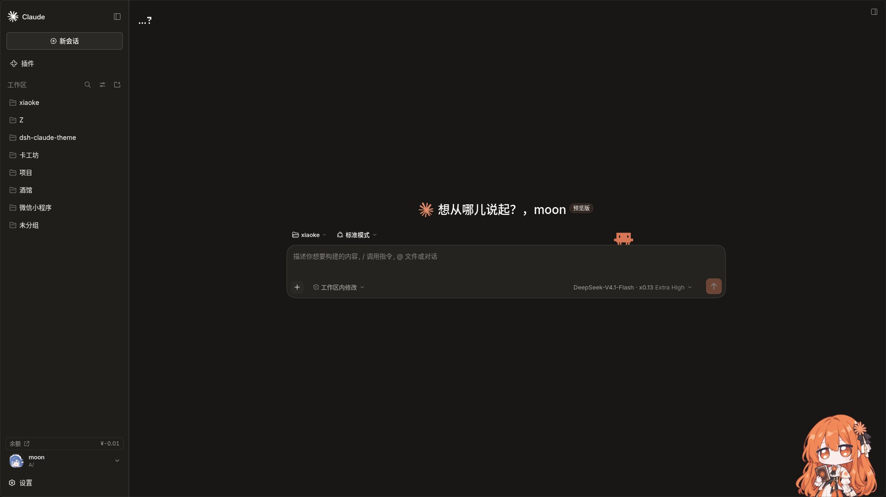

|  |  |
| --- | --- |

> ~~**我看鲸小妹和克小妹也是一对苦命鸳鸯啊。**~~

# Claude — DSH Web GUI 主题

> ~~**Anthropic 觉得侵权可以联系我下架。**~~

把 DSH Web GUI 换成 claude.ai 的样子：暖米色画布、衬线正文、珊瑚色强调。

这个仓库里有六样东西，**按需安装，不需要全装**：

| 想做什么 | 装什么 |
| --- | --- |
| 只想换配色、字体和界面细节 | 皮肤 `claude/`（走皮肤中心或 `plugins/skin/` 安装） |
| 想换侧栏的 Claude 标记、名字、头像和加载动画 | `brand-plugin/` |
| 想养一只会眨眼、会犯困的像素蟹 | `crab-plugin/` |
| 想自己换三组字体 | `plugins/font-switcher/` |
| 想在同一个 Wi-Fi 下用手机打开 DSH | `plugins/lan-access/`，详见[它的说明](plugins/lan-access/README.md) |
| 不装皮肤中心，还想独立加载皮肤并打开 Claude-X 设置页 | `plugins/skin/` |

**只装皮肤中心也能用，但不会有这些插件功能**：Claude 品牌标记、名字和头像、加载动画、字体切换、像素蟹。它们都在各自的插件里，不在皮肤的 CSS 里。

`plugins/lan-access/` 会修改 DSH 的监听配置，让同一网络里的设备能打开界面。**不需要手机访问的话，不要装它。**

## 长什么样





这是实际运行界面的截图：亮色是暖米色，暗色是暖黑，不是简单的反色。

## 装了以后能看到什么

- **暖米色 / 暖黑两套画布**，正文和标题用 Newsreader 衬线体，按钮和菜单用 Inter，代码用 JetBrains Mono。
- **自带四份字体**，不需要另外下载；中文走系统字体回退。
- **侧栏可以换成 Claude 的标记和字标**，还能改名字、副标题和头像，默认显示 `moon`。
- **加载动画三选一**：星芒（八种形态轮播）、敲键盘的像素蟹，或保留原来的鲸尾。默认星芒，在 **设置 → Claude-X** 里选。
- **24 句问候语轮换**，第一句按时间问候，会带上你设的名字。
- **像素蟹**会跟着鼠标看、会眨眼、会犯困，戳一下会说句话。它只在 `crab-plugin/` 里，皮肤本身不画第二只。
- **其他插件的界面也会顺手统一一下**，不会突然冒出一块很跳的颜色。

皮肤只管外观；换标记、头像、加载动画、像素蟹这些需要对应的插件。**皮肤和插件可以分开装**：只装皮肤，配色和字体照常工作；只装插件，也能用，只是颜色跟随官方主题。

## 怎么装

每种东西单独装，重启 DSH 后生效。**只有皮肤要先选一种安装方式，不要两种方式同时用。更推荐独立皮肤插件，功能更完整，也不用额外装一套皮肤中心。**

### 一、皮肤

**方式 A：皮肤中心。** 先装 `@linxin666/dsh-client-ui-skin-center`，在市场里搜 Claude 安装，再到 **设置 → 皮肤中心** 选中 Claude。不用手动拷贝，也不用重启。

**方式 B：独立皮肤插件（推荐）。** 不需要皮肤中心：

```bash
dsh plugin --profile web add link:/path/to/dsh-claude-theme/plugins/skin
```

重启后在 **设置 → Claude-X** 选中 Claude。插件会自己把 `claude/` 复制到 `$DSH_HOME/skins/claude`，不用你手动搬文件；已经存在的文件不会被覆盖。

### 二、Claude 品牌插件

```bash
dsh plugin --profile web add link:/path/to/dsh-claude-theme/brand-plugin
```

重启后侧栏会换成 Claude 的标记和字标，标签页标题、图标也会变。名字、头像和加载动画也能改。

只装这个插件时，点侧栏底部那一行就能改名字和头像。再装 `plugins/skin/`，会多一个 **设置 → Claude-X** 页面，加载动画也在那里选。

### 三、像素蟹

```bash
dsh plugin --profile web add link:/path/to/dsh-claude-theme/crab-plugin
```

重启后，输入框上沿会出现那只蟹，戳一下有反应。

### 四、字体切换

```bash
dsh plugin --profile web add link:/path/to/dsh-claude-theme/plugins/font-switcher
```

重启后打开 **设置 → 字体**，把字体文件放进它显示的文件夹，再点「重新扫描」。可以按用途放进 `serif/`、`sans/`、`mono/` 子文件夹。

字体文件要自备，仓库里只有皮肤自带的那四份。

### 五、手机访问（可选）

```bash
dsh plugin --profile web add link:/path/to/dsh-claude-theme/plugins/lan-access
```

重启后点侧栏的「手机访问」，打开开关，再按提示重启一次。以后扫面板里的二维码就能在手机上打开 DSH。

**二维码里的链接就是访问凭证**，不要分享给别人；只在可信的局域网里开。具体注意事项见 [`plugins/lan-access/README.md`](plugins/lan-access/README.md)。

更细的安装、排错和回滚步骤见 [`INSTALL.md`](INSTALL.md)。**嫌麻烦的话，也可以把安装交给 DSH、Claude Code 或 Codex 来做。**

### 关于安装方式，有几点要先说清

**这个仓库没有发布到 npm。** 所有插件都是先在本地克隆仓库，再用 `link:` 指向你自己的克隆路径，也就是上面各节那种命令。npm 上同名的包不是这里的，别装混了。

**不要用 `github:` 依赖 + `link:node_modules\<仓库名>\<子目录>` 这种装法。** 仓库根目录没有 `package.json`，我们没有测试过这种组合，也不打算支持它。已经有用户反馈在 Windows 上这样装会失败：`pnpm` 想替换被 DSH 占着的目录时报 `EPERM`，几次之后那几个子目录会卡在「删除挂起」状态，只能完全退出 DSH 才清理得掉，而界面上只显示「没有写入权限」，看不出真正原因。

**本项目在 Linux 上开发和维护**，Windows 上的具体行为我们没法验证。上面那条是转述别人的反馈，不是我们复现过的结论。如果你在 Windows 上遇到问题，欢迎开 issue 描述现象，但请理解我们不一定能跟进到底。

已经在用那种装法、目前也正常的，不用急着改；只是出问题时，先别怀疑是 DSH 或这些插件本身坏了。

## 这些东西怎么配合

- 名字、副标题、头像存在 `dsh-claude-brand.prefs` 里。侧栏弹窗和 Claude-X 页改的是同一份数据，改完两边同步。
- 加载动画也存在同一份设置里，目前在 Claude-X 页选择。
- 两个插件不能直接共享模块，所以用 localStorage 存共享数据，用 window 事件通知对方刷新。
- 字体切换插件只处理当前皮肤的字体；没装皮肤，它就没有可换的对象。
- 皮肤为什么不做品牌替换：皮肤中心不执行本地皮肤的官方钩子，换 logo 只能由插件来做。详见下面的已知限制。

## 目录结构

```
dsh-claude-theme/
├── claude/                          # 皮肤本体
│   ├── skin.json                    #   皮肤的信息（名字、作者、配色）
│   ├── skin.css                     #   全部配色和字体定义
│   ├── patches.css                  #   细节调整（圆角、输入框、卡片、滚动条）
│   ├── assets/fonts/                #   自带的四个字体文件 + 重新下载脚本
│   ├── preview/                     #   预览图（真机截图，亮暗各一张）
│   ├── crab.generated.css           #   问候语旁的像素星星（生成文件，勿手改）
│   └── patches.base.css             #   patches.css 的手写底稿
├── plugins/
│   ├── skin/                        # 皮肤插件
│   │   ├── README.md                #   它是怎么让皮肤生效的
│   │   ├── lib/index.js             #   读皮肤、把样式送进页面、管字体图片
│   │   ├── lib/css-contract.js      #   样式改写（详见它自己的 README）
│   │   ├── lib/client.js            #   设置页（Claude-X）
│   │   └── test/                    #   单测
│   └── font-switcher/               # 字体切换插件
│       ├── README.md
│       ├── lib/index.js             #   扫描字体文件夹
│       └── lib/client.js            #   设置页（字体）
├── plugins/lan-access/              # 局域网访问插件（独立于皮肤）
│   ├── README.md                    #   安装、使用与安全边界
│   ├── lib/index.js                 #   监听配置、链接与二维码
│   └── lib/client.js                #   手机访问面板
├── crab-plugin/                     # Clawd 插件
│   ├── LICENSE                      #   MIT + Clawd 署名
│   ├── README.md
│   ├── docs/preview.png             #   预览图
│   └── lib/client.js                #   蟹本体：像素画、动画、台词
├── pet/                             # 给宠物系统用的蟹图集
├── brand-plugin/                    # Claude 插件
│   ├── README.md
│   ├── assets/default-avatar.webp   #   默认头像
│   └── lib/client.js                #   星芒、字标、问候语、名字头像
├── cover/                           # 封面图（视频封面 + 仓库卡片两种比例）
├── scripts/                         # 维护脚本（重新生成皮肤、校验、截图等）
├── README.md                        # 本文件
├── README.en.md                     # 英文版
├── INSTALL.md                       # 逐步安装与排错
└── LICENSE                          # MIT + 字体与商标声明
```

`scripts/` 的用法见 [`scripts/README.md`](scripts/README.md)。

## 已知限制

- **皮肤跑不了官方的钩子脚本。** 皮肤中心只放行从它市场里装来的皮肤，本地的直接拒绝。所以换 logo 这类事只能做成插件，做不成皮肤的一部分。
- **远程字体两条路不一样。** 走皮肤中心时，字体必须放在皮肤目录里，引用外面的会被拒。走独立皮肤插件没有这个限制——但也因此不帮你把关，只装自己写得明白的皮肤。
- **工具调用卡片是照着感觉画的。** claude.ai 没有这个东西（它是 DSH 特有的界面），所以是按 Claude 的风格重绘的，不是 1:1 复刻。
- **蟹的画法来自别人。** 像素点阵取自酒馆扩展 [claude-web](https://github.com/claudenoshujin/claude-web)（作者 **claudenoshujin**），画法的功劳归他；这里的选择器、动画、配色、摆放都是自己写的。详情见下面[许可与声明](#许可与声明)。
- **宠物面板里的蟹不会动。** 宠物系统要一套九格动画图，而蟹只有一组静态像素，所以九格是同一只蟹换着色。想要真动画得补美术。
- **蟹不走官方的插槽系统。** 走过，出过事故：报错被吞掉、插件装了蟹却不出现、还不报错。现在直接挂在输入框上。代价是官方哪天改了那个位置的标记，蟹会消失——不过控制台会留一句警告，不是无声无息。
- **皮肤不再自己画蟹。** 早期皮肤带过一只静态蟹，和插件蟹打架（两只蟹或没有蟹），后来删了。现在蟹只在插件里，只装皮肤的话输入框上沿没有蟹。
- **皮肤只对选中的页面生效。** 样式都圈在皮肤自己的地盘里，换别的皮肤不会串味。两条安装路径都是这样。

## 许可与声明

- 代码与 CSS：MIT，见 [`LICENSE`](LICENSE)。
- 内置字体：Newsreader、Inter、JetBrains Mono 均为 SIL Open Font License 1.1 授权，随附于 `claude/assets/fonts/`。
- 商标：这是**非官方粉丝复刻**。"Claude" 与 "Anthropic" 是 Anthropic PBC 的商标。本项目与 Anthropic 无任何隶属或背书关系。
- **Clawd 的署名。** Clawd（Claude Code 的像素蟹吉祥物）属于 Anthropic。本仓的蟹是**纯 CSS**：由 `scripts/gen-crab.py` 从像素点阵数据生成，不含任何图片文件。点阵几何源自酒馆扩展 [claude-web](https://github.com/claudenoshujin/claude-web)，作者 **claudenoshujin**——原像素美术的功劳归该作者。本项目只复用几何数据，未从该仓库复制任何文件；选择器、动画、配色、摆放均为自写。
- **星芒动画的版权。** 「加载动画」里的星形素材属于 Anthropic，此处按非官方粉丝复刻的用途引用。本项目与 Anthropic 无隶属或背书关系。
- **Copernicus 和 StyreneB 未包含在内。** 这两个是 Anthropic 实际使用的字体，属于商业授权字体，不能分发。本项目用开源的 Newsreader（替代 Copernicus 的衬线角色）和 Inter（替代 StyreneB 的无衬线角色）作为替代品——形似但不等同。

## 致谢

- 皮肤中心插件 [`@linxin666/dsh-client-ui-skin-center`](https://github.com/zhu1090093659/dsh-web)：提供了皮肤加载、清单校验、CSS 清洗与热切换的整套机制。
- Newsreader、Inter、JetBrains Mono 的字型作者与 Google Fonts 的 latin 子集构建。
- Anthropic 的 claude.ai 界面：本项目是照着它的观感做的复刻。
- 酒馆扩展 [claude-web](https://github.com/claudenoshujin/claude-web)（作者 **claudenoshujin**）：Clawd 像素几何数据的来源，也是配色与观感的重要参照。
